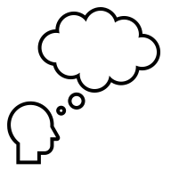

```{r}
#| echo: false
#| include: false

library(tarifr)
library(ggplot2)

couleurs_act <- c(
  rouge = "#e30513",
  bleu = "#009cde",
  or = "#ffc103",
  vert = "#3d8b5f",
  gris = "#626974"
)

theme_act <- theme_minimal(base_size = 14) +
  theme(
    panel.grid.minor = element_blank(),
    panel.grid.major.x = element_blank()
  )
```

## Lectures recommandées

Ce chapitre est adapté du chapitre 11 du texte *Basic Ratemaking* :

[Werner, G. et Modlin, C. (2016). *Basic Ratemaking*, Casualty Actuarial Society, 5e édition.](http://www.casact.org/library/studynotes/Werner_Modlin_Ratemaking.pdf)

## Contenu du chapitre {.progress-overview}

# Analyse de territoires {data-progress-label="Territoires"}

## Territoires

L'expérience de sinistre observée contient du signal et du bruit.

- Le signal provient de facteurs **non géographiques** et **géographiques**.
- L’analyse territoriale cherche à isoler l’effet géographique réel, après ajustement pour les autres variables.
- Les écarts aléatoires entre petites zones ne doivent pas influencer directement la tarification.
- Les assureurs définissent des territoires et utilisent ces territoires pour déterminer la prime de l’assuré.

---

La tarification des territoires implique normalement deux phases :

1. Définir les frontières de chaque territoire.
2. Déterminer le différentiel associé à chaque territoire.

## Définir les frontières de chaque territoire

On détermine d’abord une **unité géographique** de base qui est assez raffinée pour :

- Être relativement homogène
- Contenir assez d’observations dans chaque unité

Exemples d’unités géographiques :

- Code postal à 6 positions
- Code postal à 3 positions

---

On utilisera ensuite un maximum de données liées à des données démographiques (ex. : densité de population, score de crédit moyen, etc.) et à des données géographiques (ex. : précipitations moyennes, taux de criminalité, etc.) pour finalement calculer le résidu pour chaque unité géographique.

:::::: {.rows .center}
::::: {.row}
:::: {.columns}
::: {.column width="33%"}
**Prédicteurs non-géographiques**
:::
::: {.column width="33%"}
**Prédicteurs géographiques et démographiques**
:::
::: {.column width="33%"}
**Variation résiduelle liée à la géographie**
:::
::::
:::::
::::: {.row}
:::: {.columns}
::: {.column width="33%"}
- Âge du conducteur
- Type de véhicule
:::
::: {.column width="33%"}
- Densité de population
- Précipitations moyennes
:::
::: {.column width="33%"}
:::
::::
:::::
::::::


---

Finalement, on effectue un lissage géographique puisque le risque géographique a tendance à être similaire pour des unités près les unes des autres.

Deux types de lissage spatial :

- **Basé sur la distance** : lissage des données qui donne davantage de poids aux unités géographiques plus près de l’unité analysée.
- **Basé sur les régions adjacentes** : lissage des données qui donne davantage de poids aux unités géographiques ayant une frontière en commun avec l’unité analysée.

---

On groupe ensuite les unités en territoires avec l’objectif de minimiser l’hétérogénéité dans un même territoire mais de maximiser l’hétérogénéité entre les différents territoires.

On pourrait regrouper les unités géographiques en quantiles afin d’avoir des territoires contenant chacun un nombre d’unités d’exposition similaire.

## Déterminer le différentiel associé à chaque territoire

Comme la variable territoire est habituellement fortement corrélée avec plusieurs autres variables, il est important d’utiliser des méthodes multivariées pour déterminer le différentiel indiqué pour chaque territoire.

La variable « territoire » est simplement une autre variable de tarification dans un modèle multivarié.


# Tarification des limites augmentées {data-progress-label="Limites"}

## Limites augmentées

En responsabilité civile, différentes limites de montant d’assurance sont offertes aux clients. Typiquement, le plus petit niveau d’assurance est la **limite de base** et les limites supérieures sont appelées les **limites augmentées**.

Par exemple, en assurance automobile un assureur pourrait offrir un minimum de 1M \$ en responsabilité civile (limite de base) et aussi offrir la possibilité à l’assuré d’acheter plutôt des limites de 2M \$, 3M \$, 4M \$ (limites augmentées).

La présente section explique comment calculer le **facteur de limite augmentée**, qui correspond à la surcharge que l’assureur devrait appliquer pour passer de la limite de base à une limite augmentée.

---

Il est possible de faire des analyses univariées (chapitre 9) ou multivariées (chapitre 10) pour déterminer les différentiels indiqués pour les différents niveaux de limite d’assurance (facteur de limite augmentée).

Cependant, comme ce sont des sinistres peu fréquents, les résultats de ces analyses ne sont pas toujours crédibles et souvent volatiles.

## Calcul des facteurs de limites augmentées

### Notation

- **$ILF(H)$** : Facteur de limite augmentée pour la limite $H$.
- **$B$** : Taux de base (pour la limite de base).
- **$H$** : Limite sélectionnée.
- **$LAS(H)$** : Sévérité des sinistres écrêtés à $H$ (*limited average severity* à $H$).

---

### Sinistres non censurés

Si la base de données de l’assureur contient le montant total de la perte avant l’application de la limite de couverture, on dira que les sinistres sont non censurés.

::: {.text-small}

**Hypothèses :**

- Tous les frais de souscription sont variables.
- Les frais de souscription variables sont un pourcentage constant de la prime et ce pourcentage ne varie pas selon le niveau de limite.
- Le profit est un pourcentage constant de la prime et ne varie pas selon le niveau de limite.
- La fréquence et la sévérité de perte sont indépendantes.
- La fréquence est la même peu importe la limite d’assurance.

:::

---

::: {.text-smaller}
$$
ILF(H)_{\text{indiqué}}
= \frac{(L + E_L)_H}{(L + E_L)_B}
$$

Puisque la fréquence et la sévérité sont indépendantes :

$$
ILF(H)_{\text{indiqué}}
= \frac{\text{Fréquence}_H \times \text{Sévérité}_H}
       {\text{Fréquence}_B \times \text{Sévérité}_B}
$$

Puisque la fréquence ne varie pas par limite d’assurance ($\text{Fréquence}_H = \text{Fréquence}_B$) :

$$
ILF(H)_{\text{indiqué}} = \frac{\text{Sévérité}_H}{\text{Sévérité}_B} = \frac{LAS(H)}{LAS(B)}
$$
:::

:::: {.question title="ILF avec sinistres non censurés"}

::: {.text-small}

Avec les données suivantes :

- La limite de base est 100 000 $.
- Les sinistres non censurés sont disponibles.

| Montant de perte | Nombre de réclamations | Sinistres |
|:--|--:|--:|
| $X \leq 100\,000$ | 2 324 | 117 629 223 $ |
| $100\,000 < X \leq 250\,000$ | 1 923 | 307 599 929 $ |
| $250\,000 < X \leq 500\,000$ | 680 | 222 793 514 $ |
| $500\,000 < X \leq 1\,000\,000$ | 73 | 43 047 470 $ |
| **Total** | **5 000** | **691 070 136 $** |

Calculer le facteur de limite augmentée indiqué à 250 000 $.

:::

::: {.solution .text-smaller}

$$
ILF(250\,000)_{\text{indiqué}}
= \frac{LAS(250\,000)}{LAS(100\,000)}
$$

$$
LAS(100\,000) = \frac{117\,629\,223 + 100\,000 \times (1\,923 + 680 + 73)}{5\,000} = 77\,046
$$

$$
LAS(250\,000) = \frac{117\,629\,223 + 307\,599\,929 + 250\,000 \times (680 + 73)}{5\,000} = 122\,696
$$

$$
ILF(250\,000)_{\text{indiqué}}
= \frac{122\,696}{77\,046} = \textbf{1.59}
$$

:::
::::

## Calcul des facteurs de limites augmentées

### Sinistres censurés

Malheureusement, la base de données d’un assureur ne contient habituellement que les montants des pertes censurées à la limite de la police, c’est-à-dire après l’application de la limite.

Par exemple, si la limite de police est 1 M \$ et que l’assuré a été responsable pour 3 M \$, le montant de perte dans la base de données de l’assureur est 1 M \$.

La méthode consiste à utiliser le plus de données possibles, sans le biais lié à l’écrêtement.

:::: {.question title="ILF avec sinistres censurés"}

::: {.text-xs}

Avec les données suivantes :

- La limite de base est 100 000 $.
- Les sinistres censurés à la limite de police sont disponibles.

```{r}
#| label: censored-losses-limit-table
#| echo: false
#| output: asis

lignes_limites <- data.frame(
  montant = c(
    "$X \\leq 100\\,000$",
    "$100\\,000 < X \\leq 250\\,000$",
    "$250\\,000 < X \\leq 500\\,000$",
    "$500\\,000 < X \\leq 1\\,000\\,000$"
  ),
  reclamations_100 = c(2019, NA, NA, NA),
  sinistres_100 = c(156657898, NA, NA, NA),
  reclamations_250 = c(690, 773, NA, NA),
  sinistres_250 = c(34903214, 142767479, NA, NA),
  reclamations_500 = c(712, 574, 232, NA),
  sinistres_500 = c(35768111, 90009422, 81092725, NA),
  check.names = FALSE
)

totaux_limites <- lignes_limites[1, , drop = FALSE]
totaux_limites$montant <- "Total"
for (colonne in names(lignes_limites)[-1]) {
  totaux_limites[[colonne]] <- sum(lignes_limites[[colonne]], na.rm = TRUE)
}

tableau_limites <- rbind(lignes_limites, totaux_limites)
names(tableau_limites) <- c(
  "Montant de perte",
  rep(c("Nombre de réclamations", "Sinistres"), 3)
)

afficher_tableau_limites <- function(tableau) {
  afficher_table(
    tableau,
    align = c("l", rep("r", 6)),
    formats = list(
      list(colonnes = c(2, 4, 6), type = "nombre", digits = 0),
      list(colonnes = c(3, 5, 7), type = "montant", symbole = TRUE)
    ),
    lignes_gras = "derniere",
    entetes_groupes = list(
      list(
        label = "Réclamations sur les polices avec limite de 100 000 \\$",
        colonnes = 2:3
      ),
      list(
        label = "Réclamations sur les polices avec limite de 250 000 \\$",
        colonnes = 4:5
      ),
      list(
        label = "Réclamations sur les polices avec limite de 500 000 \\$",
        colonnes = 6:7
      )
    )
  )
}

afficher_tableau_limites(tableau_limites)
```

Calculer le facteur de limite augmentée indiqué à 250 000 $.

:::

::: {.solution}

##

La méthode consiste à utiliser le plus de données possibles, sans le biais lié à l’écrêtement.

$$
ILF(250\,000)_{\text{indiqué}}
= \frac{LAS(250\,000)}{LAS(100\,000)}
$$

::: {.text-smaller}
$$
\begin{aligned}
&LAS(250\,000) \\
&= LAS(100\,000) \\
&\quad + P(X > 100\,000) \times (\text{Sévérité pour la tranche de 100\,000 à 250\,000 sachant} \\
&\qquad \qquad \qquad \qquad \qquad \text{que le montant de la perte est supérieur à 100\,000})
\end{aligned}
$$

:::

où $X$ est le montant de la perte avant l’application de la limite de police.

##

::: {.text-xs}

```{r}
#| label: censored-losses-las-100k-table
#| echo: false
#| output: asis

afficher_tableau_limites(tableau_limites)
```

:::

::: {.text-smaller}

$$
\begin{aligned}
LAS(100\,000)
&= \text{Sévérité des pertes écrêtées à 100 000} \\
&= \frac{156\,657\,898 + 34\,903\,214 + 35\,768\,111 + 100\,000 \times (773 + 574 + 232)}{2\,019 + 1\,463 + 1\,518} \\
&= 77\,046
\end{aligned}
$$


:::

##

::: {.text-xs}

```{r}
#| label: censored-losses-probability-table
#| echo: false
#| output: asis

afficher_tableau_limites(tableau_limites)
```

:::

::: {.text-small}

$$
\begin{aligned}
P(X > 100\,000)
&= \frac{773 + 574 + 232}{1\,463 + 1\,518} \\
&= 0.529688024
\end{aligned}
$$

:::

##

::: {.text-xs}

```{r}
#| label: censored-losses-severity-table
#| echo: false
#| output: asis

afficher_tableau_limites(tableau_limites)
```

:::

::: {.text-xs}

Sévérité pour la tranche 100 000 à 250 000, sachant que le montant de la perte est supérieur à 100 000 :

$$
\begin{aligned}
&= \frac{
  [142\,767\,479 - 100\,000 \times 773]
  + [90\,009\,422 - 100\,000 \times 574]
  + [232 \times (250\,000 - 100\,000)]
}{773 + 574 + 232} \\
&= 84\,153
\end{aligned}
$$

:::

##

$$
\begin{aligned}
ILF(250\,000)_{\text{indiqué}}
&= \frac{LAS(250\,000)}{LAS(100\,000)} \\
&= \frac{77\,046 + 0.529688024 \times 84\,153}{77\,046} \\
&= \frac{121\,621}{77\,046} \\
&= \textbf{1.58}
\end{aligned}
$$

:::
::::

## Calcul des facteurs de limites augmentées

**Sinistres censurés**

Comme le but est de calculer les facteurs de limites augmentées pour la période de police future, les sinistres utilisés dans l’analyse devraient être les sinistres **ultimes** et **projetés pour la période future**.

- *Rappel du chapitre 6 : une tendance dans les montants de perte n’a pas le même impact sur les sinistres écrêtés à la limite de base que dans les sinistres excédentaires*.

## Modélisation des données à l’aide d’une courbe théorique {.text-small}

On détermine d’abord une loi pour la distribution du montant de la perte (lognormale, Pareto, Pareto tronquée, etc.).

### Notation

$f(x)$ : Distribution continue des sinistres de montant $x$

$H$ : Limite de police

$$
LAS(H) = \int_0^H x f(x)\,dx + H\int_H^\infty f(x)\,dx
$$

$$
ILF(H) = \frac{\int_0^H x f(x)\,dx + H\int_H^\infty f(x)\,dx}{\int_0^B x f(x)\,dx + B\int_B^\infty f(x)\,dx}
$$

# Tarification des franchises {data-progress-label="Franchises"}

## Franchise {.english-subtitle subtitle="Deductible"}

Une franchise est le montant restant à la charge de l’assuré lors d’une réclamation.

L’assuré est donc responsable des premiers dollars de perte jusqu’à concurrence du montant de la franchise et l’assureur paiera le montant supérieur à la franchise, jusqu’à concurrence de la limite d’assurance.

## Franchise {.text-small}

Deux types de franchises répandus :

1. Franchise en dollars
  - Spécifie un montant en dessous duquel les sinistres ne sont pas couverts.
    - Franchise de 500 $ sur la couverture bâtiment en assurance habitation.
    - Franchise de 100 000 $ sur la couverture bâtiment en assurance commerciale.

2. Franchise en pourcentage
  - Spécifie un pourcentage du montant d’assurance en dessous duquel les sinistres ne sont pas couverts.
    - Franchise de 5% pour la couverture tremblement de terre en assurance habitation. Pour un bâtiment de 500 000\$, la franchise sera de $0.05 \times 500\,000\ \text{\$} = 25\,000\ \text{\$}$.

## Avantages des franchises

### Réduction de la prime
- L’assuré peut être prêt à assumer une portion des pertes en cas de réclamation en échange d’une baisse de prime.

---

### Élimination des petites réclamations de nuisance
- Avec une police sans franchise (franchise = 0 $), il est avantageux pour l’assuré de faire une
demande de réclamation pour tous les sinistres.
- Pour une perte de faible montant, l’assureur
encoure des frais de règlement de sinistres qui peuvent parfois être plus élevés que le montant
de l’indemnité versée à l’assuré.
- Une franchise diminue donc la fréquence de ces petites
réclamations de nuisance. Cela permet donc à l’assureur de mieux contrôler ses frais de
règlement de sinistre et donc d’offrir des primes plus basses.

---

### Incitatif au contrôle des pertes
- Comme il assume une partie des pertes, l’assuré a un incitatif financier à éviter d’avoir une
perte.

---

### Contrôle l’exposition aux catastrophes
- Lorsqu’un assureur écrit un nombre élevé de polices dans une certaine région, l’assureur est
exposé à une perte élevée en cas d’un évènement catastrophique dans cette région qui touche
plusieurs assurés.
- En ayant des franchises élevées pour des périls à potentiel catastrophique (ex:
tremblement de terre), l’assureur peut ainsi diminuer significativement son exposition au risque
et réduire la probabilité de ne pas être en mesure de rencontrer ses obligations en cas de
catastrophe.

## Tarification des franchises

Plusieurs méthodes permettent de déterminer les différentiels indiqués pour les différents niveaux de franchise :

- Méthodes de la prime pure, du taux de sinistre ou de la prime pure ajustée
  - Les données sont groupées par franchise et une méthode présentée au chapitre 9 est appliquée.
- Méthodes de classification multivariée
  - Un modèle multivarié est appliqué sur les données et la variable franchise est incluse dans ce modèle (ex : GLM présenté au chapitre 10).
- **Approche du ratio d'élimination des pertes**

## Approche du ratio d’élimination des pertes {.english-subtitle subtitle="Loss Elimination Ratio"}

**Hypothèses** :

- Tous les frais de souscription sont variables.
- Les frais de souscription variables sont un pourcentage constant de la prime et ce pourcentage ne varie pas selon le niveau de franchise.
- Le profit est un pourcentage constant de la prime et ne varie pas selon le niveau de franchise.

## Approche du ratio d’élimination des pertes

Calcul du différentiel indiqué pour une police avec franchise $D$ (pour des fins d’illustration, la classe de base est une police sans franchise) :

$$
\text{Différentiel indiqué pour franchise }D
= \frac{(\overline{L + E}_L)_D}{(\overline{L + E}_L)_B}
\tag{1}
$$

---

On définit $LER(D)$, soit le ratio d’élimination des pertes pour une franchise $D$ :

::: {.text-smaller}
$$
\begin{aligned}
LER(D)
&= \frac{\text{Sinistres et frais de règlement de sinistres } \textbf{éliminés par la franchise}}
         {\text{Sinistres et frais de règlement de sinistres totaux}} \\
&= \frac{(L + E_L)_B - (L + E_L)_D}{(L + E_L)_B}
\end{aligned}
$$
$$
\Rightarrow (L + E_L)_D
= (L + E_L)_B\left(1 - LER(D)\right)
\tag{2}
$$

:::


---

En remplaçant l’équation (2) dans l’équation (1), on obtient le différentiel indiqué :

$$
\begin{aligned}
\text{Différentiel indiqué pour franchise }D
&= \frac{(\overline{L + E}_L)_B\left(1 - LER(D)\right)}
         {(\overline{L + E}_L)_B} \\
&= \mathbf{1 - LER(D)}
\end{aligned}
$$


::: {.aside}
La même logique s’applique lorsque la classe de base n’est pas la franchise de 0 $. Dans ce cas, on calcule le ratio d’élimination de pertes par rapport à la franchise de base.
:::

## Approche du ratio d’élimination des pertes

### Sinistres non censurés

Lorsque tous les montants totaux de perte (c’est-à-dire avant considération de la franchise) sont connus, on a :

::: {.text-xs}
$$
\begin{aligned}
LER(D)
&= \frac{\text{Sinistres et frais de règlement de sinistres } \textbf{éliminés par la franchise}}
         {\text{Sinistres et frais de règlement de sinistres totaux}} \\
&= 1 - \frac{\text{Sinistres et frais de règlement de sinistres }\textbf{non éliminés par la franchise}}
             {\text{Sinistres et frais de règlement de sinistres totaux}}
\end{aligned}
$$

$$
LER(D)
= 1 -
\frac{\displaystyle \sum_{\text{tous les sinistres}}
      \max\left[0,\left(\text{Montant de perte} - D\right)\right]}
     {\displaystyle \sum_{\text{tous les sinistres}} \text{Montant de perte}}
$$
:::

```{r}
#| label: uncensored-losses-table-data
#| echo: false
#| include: false

tableau_ler <- data.frame(
  montant = c(
    "$0 \\leq X < 100$",
    "$100 \\leq X < 250$",
    "$250 \\leq X < 500$",
    "$500 \\leq X < 1\\,000$",
    "$1\\,000 \\leq X$"
  ),
  reclamations = c(3200, 1225, 1187, 1845, 2543),
  sinistres = c(240365, 207588, 463954, 1551938, 11140545),
  check.names = FALSE
)

total_ler <- data.frame(
  montant = "Total",
  reclamations = sum(tableau_ler$reclamations),
  sinistres = sum(tableau_ler$sinistres),
  check.names = FALSE
)

tableau_ler <- rbind(tableau_ler, total_ler)
names(tableau_ler) <- c(
  "Montant de perte",
  "Nombre de réclamations rapportées",
  "Sinistres rapportés avant considération de la franchise"
)

afficher_tableau_ler <- function() {
  afficher_table(
    tableau_ler,
    align = c("l", "r", "r"),
    formats = list(
      list(colonnes = 2, type = "nombre", digits = 0),
      list(colonnes = 3, type = "montant", symbole = TRUE)
    ),
    lignes_gras = "derniere"
  )
}
```

:::: {.question title="Ratio d’élimination des pertes avec sinistres non censurés"}

ICI ICI ICI


::: {.fdjsifowe .fdsjkl smart-tables-width="full" tbl-colwidths="[30,31,45]"}

Avec les données suivantes, calculer $LER(250)$.

```{r}
#| label: uncensored-losses-table-question
#| echo: false
#| output: asis

afficher_tableau_ler()
```

:::

::: {.solution}

##

### Calcul à partir des sinistres éliminés

::: {smart-tables-width="full" tbl-colwidths="[24,31,45]"}

```{r}
#| label: uncensored-losses-table-eliminated
#| echo: false
#| output: asis

afficher_tableau_ler()
```

:::

$$
\begin{aligned}
LER(D)
&= \frac{\text{Sinistres et frais de règlement de sinistres éliminés par la franchise}}
         {\text{Sinistres et frais de règlement de sinistres totaux}} \\
LER(250)
&= \frac{240\,365 + 207\,588 + 250 \times (1\,187 + 1\,845 + 2\,543)}{13\,604\,390} \\
&= \textbf{0.135}
\end{aligned}
$$

##

### Calcul à partir des sinistres non éliminés

::: {smart-tables-width="full" tbl-colwidths="[24,31,45]"}

```{r}
#| label: uncensored-losses-table-not-eliminated
#| echo: false
#| output: asis

afficher_tableau_ler()
```

:::

On peut aussi calculer le ratio d’élimination des pertes à partir des sinistres non éliminés par la franchise :

$$
LER(D)
= 1 - \frac{\sum_{\text{tous les sinistres}} \max(0, \text{Montant de perte} - D)}
           {\sum_{\text{tous les sinistres}} \text{Montant de perte}}
$$

$$
\begin{aligned}
LER(250)
&= 1 - \frac{3\,200 \times 0 + 1\,225 \times 0 + (463\,954 - 1\,187 \times 250)
           + (1\,551\,938 - 1\,845 \times 250)
           + (11\,140\,545 - 2\,543 \times 250)}{13\,604\,390} \\
&= \textbf{0.135}
\end{aligned}
$$

:::
::::

## Approche du ratio d’élimination des pertes {.english-subtitle subtitle="Censored Losses"}

### Sinistres censurés

:::: {.columns}
::: {.column width="58%"}
En pratique, un assureur offre des polices avec plusieurs niveaux de franchise (ex. : 0 $, 100 $, 250 $, 500 $, 1 000 $, etc.).

Il est fort fréquent qu’un assureur ne connaisse pas tous les montants de sinistres avant de considérer la franchise.

En effet, l’assureur a souvent seulement la portion des sinistres excédant la franchise, c’est-à-dire les pertes nettes de la franchise.
:::
::: {.column width="42%"}
::: {.callout-note title=""}
La franchise de mon contrat d’assurance habitation est de 500 $. Vais-je appeler mon assureur pour signaler le cellulaire de 300 $ que je me suis fait voler ?
:::

{.nostretch width="70%" fig-alt="Personne qui se demande si elle doit déclarer un petit sinistre lorsque la franchise est élevée."}
:::
::::

---

### Utilisation des données censurées

On essayera de prendre le plus de données possibles pour faire les calculs de $LER$. Cependant, les polices avec une franchise plus élevée que la franchise pour laquelle on essaie de déterminer le différentiel ne peuvent être utilisées pour calculer le ratio d’élimination des pertes étant donné que nous n’avons que des données censurées.

:::: {.question title="Crédit pour une hausse de franchise"}

Avec les données suivantes, calculer le crédit pour passer d’une franchise de 250 $ à une franchise de 500 $.

| Franchise | Nombre de réclamations rapportées | Sinistres rapportés nets de la franchise | Sinistres rapportés nets en assumant une franchise de 500 $ | Sinistres rapportés nets en assumant une franchise de 250 $ |
|:--|--:|--:|--:|--:|
| 0 $ | 500 | 680 220 $ | 524 924 $ | 588 134 $ |
| 100 $ | 680 | 1 268 403 $ | 1 049 848 $ | 1 176 269 $ |
| 250 $ | 1 394 | 2 940 672 $ | 2 624 621 $ | 2 940 672 $ |
| 500 $ | 2 194 | 5 249 242 $ | 5 249 242 $ | Inconnus |
| 1 000 $ | 254 | 859 755 $ | Inconnus | Inconnus |
| **Total** | **5 022** | **10 998 292 $** | — | — |

::: {.solution}

##

On doit calculer le ratio d’élimination des pertes en passant d’une franchise de 250 $ à 500 $.

Pour ce faire, on calcule la proportion des sinistres avec franchise de 250 $ éliminés en passant à une franchise de 500 $, ce qui donnera ainsi le crédit applicable à la prime pour passer d’une franchise de 250 $ à 500 $.

##

::: {.callout-tip title=""}
On utilise le plus de données possibles, tout en tenant compte du biais lié aux données censurées. On ne se contente pas seulement d’utiliser les données des polices avec une franchise de 250 $.
:::

| Franchise | Réclamations | Nets de la franchise | Nets à 500 $ | Nets à 250 $ |
|:--|--:|--:|--:|--:|
| 0 $ | 500 | 680 220 $ | 524 924 $ | 588 134 $ |
| 100 $ | 680 | 1 268 403 $ | 1 049 848 $ | 1 176 269 $ |
| 250 $ | 1 394 | 2 940 672 $ | 2 624 621 $ | 2 940 672 $ |
| 500 $ | 2 194 | 5 249 242 $ | 5 249 242 $ | Inconnus |
| 1 000 $ | 254 | 859 755 $ | Inconnus | Inconnus |
| **Total** | **5 022** | **10 998 292 $** | — | — |

::: {.callout-warning title=""}
Les données des polices avec franchises de 500 $ et 1 000 $ ne peuvent pas être utilisées pour ce calcul, car il est impossible de connaître quels auraient été les sinistres rapportés avec des franchises de 250 $ et 500 $ pour ces polices.
:::

##

### Calcul du crédit

Les données pour les polices avec franchise de plus de 250 $ ne sont utilisées ni au numérateur ni au dénominateur dans notre calcul du ratio d’élimination des pertes.

$$
\begin{aligned}
\text{Crédit pour passer de }250\ \text{\$}\text{ à }500\ \text{\$}
&= \frac{(588\,134 - 524\,924) + (1\,176\,269 - 1\,049\,848) + (2\,940\,672 - 2\,624\,621)}{588\,134 + 1\,176\,269 + 2\,940\,672} \\
&= \frac{63\,210 + 126\,421 + 316\,051}{588\,134 + 1\,176\,269 + 2\,940\,672} \\
&= \textbf{10.7\,%}
\end{aligned}
$$

:::
::::

## Approche du ratio d’élimination des pertes

### Distribution continue

Si on assume une distribution continue des montants de perte, on peut calculer le ratio d’élimination des pertes, $LER(D)$, de la façon suivante :

$$
LER(D) = \frac{\int_0^D x f(x)\,dx + D\int_D^\infty f(x)\,dx}{\int_0^\infty x f(x)\,dx}
$$

::: {.callout-note title="Note"}
Cette formule s’applique lorsque la franchise de base est 0 $.
:::

## Considérations pratiques

### Niveau de la franchise et propension à réclamer

L’approche du ratio d’élimination des pertes assume que le comportement de l’assuré sera le même peu importe la franchise.

En pratique, un assuré qui réclamera une perte pour une police avec une franchise à 250 $ pourrait ne pas réclamer cette même perte s’il avait une police avec une franchise à 1 000 $ (ex. : assuré avec une perte de 1 100 $).

### Niveau de la franchise versus fréquence de réclamation

Les assurés avec une plus petite fréquence de réclamation ont tendance à choisir une police avec une franchise plus élevée. Comme l’approche du ratio d’élimination des pertes ne reconnaît pas cette particularité, elle peut conduire à une profitabilité plus élevée pour les polices avec franchise élevée que pour celles avec de basses franchises.

::: {.callout-note title="Note"}
Les méthodes présentées aux chapitres 9 et 10 reconnaissent ces différences de comportement de l’assuré selon la franchise, car les données historiques les reflètent.
:::

---

### Hausse de franchise versus diminution de prime

L’approche du ratio d’élimination des pertes résulte en un crédit à appliquer à la prime pour modifier la franchise. Dans l’exemple 11.3, le crédit pour passer d’une franchise de 0 $ à une franchise de 250 $ était de 13.5 %.

Si la prime de la police pour une franchise de 0 $ est de 3 000 $, le crédit pour passer à une franchise de 250 $ est de $3\,000\ \text{\$} \times 0.135 = 405\ \text{\$}$. Comme la réduction de prime est supérieure au changement de franchise, l’assuré aurait tout avantage à opter pour une police avec franchise à 250 $.

Un assureur pourrait décider de limiter le rabais en dollars applicable pour une franchise. Par exemple, pour passer d’une franchise de 0 $ à une franchise de 250 $, l’assureur pourrait déterminer un rabais maximal de 150 $.

# Assurance à la valeur {data-progress-label="Assurance valeur"}

## Coût de reconstruction {.text-smaller}

En assurance habitation, une variable de tarification importante est le coût de reconstruction de la maison (c’est-à-dire le montant nécessaire pour reconstruire l’habitation à neuf en cas de perte totale).

Les compagnies d’assurance posent plusieurs questions sur le bâtiment à assurer afin de déterminer leur meilleure estimation du coût de reconstruction de la maison :

- Modèle de résidence (détachée, jumelée, etc.)
- Nombre d’étages
- Forme et revêtement de la toiture
- Finition extérieure (bois, vinyle, pierre, etc.)
- Autres caractéristiques du bâtiment

::: {.callout-warning title="Attention!"}
Le coût de reconstruction n’est pas la valeur marchande ni le prix payé et exclut le prix du terrain.
:::

## Assurance à la valeur {.english-subtitle subtitle="Insurance to Value ou ITV"}

Le client qui achète une police d’assurance habitation choisit une limite d’assurance pour sa couverture du bâtiment.

Le niveau d’assurance à la valeur indique comment le montant d’assurance choisi par le client (la limite d’assurance) se compare au coût de reconstruction de la maison.

:::: {.question title="Taux indiqué selon le coût de reconstruction"}

::: {.text-smaller}

- Avec les données suivantes, calculer le taux indiqué par 1 000 $ d’assurance pour une maison ayant un coût de reconstruction de 200 000 $.
- L’assureur n’a aucun frais et le profit cible est 0 %.
- La fréquence de perte est 1 %.
- Si un sinistre survient, le montant de la perte a la distribution suivante :

| Montant de la perte ($X$) | Probabilité | Perte rapportée moyenne |
|:--|--:|--:|
| $0 < X \leq 25\,000$ | 12.5 % | 12 500 $ |
| $25\,000 < X \leq 50\,000$ | 12.5 % | 37 500 $ |
| $50\,000 < X \leq 75\,000$ | 12.5 % | 62 500 $ |
| $75\,000 < X \leq 100\,000$ | 12.5 % | 87 500 $ |
| $100\,000 < X \leq 125\,000$ | 12.5 % | 112 500 $ |
| $125\,000 < X \leq 150\,000$ | 12.5 % | 137 500 $ |
| $150\,000 < X \leq 175\,000$ | 12.5 % | 162 500 $ |
| $175\,000 < X \leq 200\,000$ | 12.5 % | 187 500 $ |

:::

##

### b) Coût de reconstruction de 250 000 $

Avec les données suivantes, calculer le taux indiqué par 1 000 $ d’assurance pour une maison ayant un coût de reconstruction de 250 000 $.

- L’assureur n’a aucun frais et le profit cible est 0 %.
- La fréquence de perte est 1 %.
- Si un sinistre survient, le montant de la perte a la distribution suivante :

| Montant de la perte ($X$) | Probabilité | Perte rapportée moyenne |
|:--|--:|--:|
| $0 < X \leq 25\,000$ | 10 % | 12 500 $ |
| $25\,000 < X \leq 50\,000$ | 10 % | 37 500 $ |
| $50\,000 < X \leq 75\,000$ | 10 % | 62 500 $ |
| $75\,000 < X \leq 100\,000$ | 10 % | 87 500 $ |
| $100\,000 < X \leq 125\,000$ | 10 % | 112 500 $ |
| $125\,000 < X \leq 150\,000$ | 10 % | 137 500 $ |
| $150\,000 < X \leq 175\,000$ | 10 % | 162 500 $ |
| $175\,000 < X \leq 200\,000$ | 10 % | 187 500 $ |
| $200\,000 < X \leq 225\,000$ | 10 % | 212 500 $ |
| $225\,000 < X \leq 250\,000$ | 10 % | 237 500 $ |

##

### c) Sous-assurance

À l’aide des données en a) et b), calculer le taux indiqué par 1 000 $ d’assurance pour une maison ayant un coût de reconstruction de 250 000 $, mais assurée pour 200 000 $.

::: {.callout-warning title="Attention"}
Le paiement de l’assureur est limité au montant d’assurance, soit 200 000 $.
:::

| Montant de la perte ($X$) | Probabilité | Perte rapportée | Paiement moyen de l’assureur |
|:--|--:|--:|--:|
| $0 < X \leq 25\,000$ | 10 % | 12 500 $ | 12 500 $ |
| $25\,000 < X \leq 50\,000$ | 10 % | 37 500 $ | 37 500 $ |
| $50\,000 < X \leq 75\,000$ | 10 % | 62 500 $ | 62 500 $ |
| $75\,000 < X \leq 100\,000$ | 10 % | 87 500 $ | 87 500 $ |
| $100\,000 < X \leq 125\,000$ | 10 % | 112 500 $ | 112 500 $ |
| $125\,000 < X \leq 150\,000$ | 10 % | 137 500 $ | 137 500 $ |
| $150\,000 < X \leq 175\,000$ | 10 % | 162 500 $ | 162 500 $ |
| $175\,000 < X \leq 200\,000$ | 10 % | 187 500 $ | 187 500 $ |
| $200\,000 < X \leq 225\,000$ | 10 % | 212 500 $ | 200 000 $ |
| $225\,000 < X \leq 250\,000$ | 10 % | 237 500 $ | 200 000 $ |

::: {.solution .text-smaller}

##

### a) Solution

::: {.text-smaller}

$$
\begin{aligned}
\text{Sévérité}
={}&12\,500 \times 0.125 + 37\,500 \times 0.125 + 62\,500 \times 0.125 + 87\,500 \times 0.125 \\
&+ 112\,500 \times 0.125 + 137\,500 \times 0.125 + 162\,500 \times 0.125 + 187\,500 \times 0.125 \\
={}&100\,000
\end{aligned}
$$

$$
\begin{aligned}
\text{Prime pure} &= \text{Fréquence} \times \text{Sévérité} \\
&= 0.01 \times 100\,000\ \text{\$} = 1\,000\ \text{\$} \\
\text{Prime indiquée} &= \frac{1\,000\ \text{\$} + 0\ \text{\$}}{1 - 0 - 0} = 1\,000\ \text{\$} \\
\text{Taux indiqué par }1\,000\ \text{\$}\text{ d’assurance} &= \frac{1\,000}{200\,000} \times 1\,000 = \textbf{5.00}\ \text{\$}
\end{aligned}
$$

:::

##

### b) Solution

::: {.text-smaller}

$$
\begin{aligned}
\text{Sévérité}
={}&12\,500 \times 0.1 + 37\,500 \times 0.1 + 62\,500 \times 0.1 + 87\,500 \times 0.1 + 112\,500 \times 0.1 \\
&+ 137\,500 \times 0.1 + 162\,500 \times 0.1 + 187\,500 \times 0.1 + 212\,500 \times 0.1 + 237\,500 \times 0.1 \\
={}&125\,000
\end{aligned}
$$

$$
\begin{aligned}
\text{Prime pure} &= \text{Fréquence} \times \text{Sévérité} \\
&= 0.01 \times 125\,000\ \text{\$} = 1\,250\ \text{\$} \\
\text{Prime indiquée} &= \frac{1\,250\ \text{\$} + 0\ \text{\$}}{1 - 0 - 0} = 1\,250\ \text{\$} \\
\text{Taux indiqué par }1\,000\ \text{\$}\text{ d’assurance} &= \frac{1\,250}{250\,000} \times 1\,000 = \textbf{5.00}\ \text{\$}
\end{aligned}
$$

:::

##

### c) Solution

::: {.text-smaller}

$$
\begin{aligned}
\text{Sévérité}
={}&12\,500 \times 0.1 + 37\,500 \times 0.1 + 62\,500 \times 0.1 + 87\,500 \times 0.1 + 112\,500 \times 0.1 \\
&+ 137\,500 \times 0.1 + 162\,500 \times 0.1 + 187\,500 \times 0.1 + 200\,000 \times 0.1 + 200\,000 \times 0.1 \\
={}&120\,000
\end{aligned}
$$

$$
\begin{aligned}
\text{Prime pure} &= \text{Fréquence} \times \text{Sévérité} \\
&= 0.01 \times 120\,000\ \text{\$} = 1\,200\ \text{\$} \\
\text{Prime indiquée} &= \frac{1\,200\ \text{\$} + 0\ \text{\$}}{1 - 0 - 0} = 1\,200\ \text{\$} \\
\text{Taux indiqué par }1\,000\ \text{\$}\text{ d’assurance} &= \frac{1\,200}{200\,000} \times 1\,000 = \textbf{6.00}\ \text{\$}
\end{aligned}
$$

:::

:::
::::

## Assurance à la valeur

Lorsque le montant d’assurance est inférieur au coût de reconstruction, on dira qu’il y a **sous-assurance**.

Deux problèmes avec la sous-assurance :

1. Le paiement d’assurance ne sera pas toujours suffisant pour couvrir les pertes (inconvénient pour le client).
2. La prime n’est pas suffisamment élevée pour couvrir les sinistres espérés (inconvénient pour l’assureur).

---

Deux façons de régler les problèmes de sous-assurance :

1. **Clause de coassurance** : pénaliser les assurés qui sont sous-assurés via le montant d’indemnité payable.
2. **Variation des taux selon le niveau d’assurance à la valeur** : charger une prime qui tient réellement compte des sinistres espérés.

## Clause de coassurance

L’assureur peut demander un montant d’assurance minimal (ex. : 80 % du coût de reconstruction), sans quoi le paiement sur les pertes couvertes sera diminué proportionnellement par le montant de sous-assurance.

Le but d’une clause de coassurance est d’atteindre une plus grande équité parmi les assurés via les paiements de réclamations plutôt que via les taux.

---

### Notation et formules

- $F$ : Montant d’assurance sur la police (montant choisi par l’assuré)
- $V$ : Valeur de la propriété ou coût de reconstruction
- $c$ : Pourcentage de coassurance exigé
  - $c \times V$ : montant d’assurance requis pour qu’aucune pénalité ne soit applicable

---

- $a$ : Ratio de répartition (*apportionment ratio*)
  - $a = \min\left(\frac{F}{cV}, 1.0\right)$

---

- $I$ : Indemnité reçue après la perte
- $L$ : Montant de la perte après la franchise

Le montant d’indemnité payable est :

$$
I = L \times \frac{F}{cV}, \qquad I \leq F \quad \text{et} \quad I \leq L
$$

---

- $e$ : Pénalité de coassurance, c'est le montant par lequel le paiement d’indemnité est réduit suite à l’application de la clause de coassurance.

Une pénalité survient lorsque les trois conditions suivantes s’appliquent :

1. Un sinistre non nul survient ($L > 0$).
2. L’assuré est sous-assuré ($F < cV$).
3. Le montant de la perte est inférieur au montant d’assurance requis ($L < cV$).

---

Le montant de la pénalité est donné par l’équation suivante :

$$
e = \begin{cases}
L - I, & \text{si } L \leq F, \\
F - I, & \text{si } F < L \leq cV, \\
0, & \text{si } cV \leq L.
\end{cases}
$$

---

### Résumé de la notation

- $I$ : Indemnité reçue après la perte
- $L$ : Montant de la perte après la franchise
- $F$ : Montant d’assurance sur la police (montant choisi par l’assuré)
- $V$ : Valeur de la propriété ou coût de reconstruction
- $c$ : Pourcentage de coassurance exigé
- $e$ : Pénalité de coassurance
- $a$ : Ratio de répartition (*apportionment ratio*)

---

:::: {.question title="Clause de coassurance"}

Une maison évaluée à 500 000 $ est assurée pour 300 000 $ malgré un pourcentage de coassurance requis de 80 %.

- Calculer le ratio de répartition.
- Calculer le montant d’indemnité versée et la pénalité de coassurance pour une perte de 200 000 $.
- Calculer le montant d’indemnité versée et la pénalité de coassurance pour une perte de 300 000 $.
- Calculer le montant d’indemnité versée et la pénalité de coassurance pour une perte de 350 000 $.
- Calculer le montant d’indemnité versée et la pénalité de coassurance pour une perte de 450 000 $.

::: {.solution}

##

### a) Ratio de répartition

$$
F = 300\,000 \\
V = 500\,000 \\
c = 0.8 \\
\\
\begin{aligned}
a
&= \min\left(\frac{F}{cV}, 1\right) \\
&= \min\left(\frac{300\,000}{0.80 \times 500\,000}, 1\right) \\
&= \min\left(\frac{300\,000}{400\,000}, 1\right) \\
&= \textbf{0.75}
\end{aligned}
$$

##

### b) Perte de 200 000 $

Pour une perte de 200 000 $ :

- L'assureur devrait payer $I = 200\,000 \times 0.75 = 150\,000 \text{\$}$.
- Le montant d'assurance choisi est $300\,000 \text{\$}$. Sans clause de coassurance, l'assureur aurait payé une indemnité de $200\,000 \text{\$} = L$.
- Donc, $e = L - I = 200\,000 - 150\,000 = 50\,000 \text{\$}$.

##

### c) Perte de 300 000 $

Pour une perte de 300 000 $ :

- L'assureur devrait payer $I = 300\,000 \times 0.75 = 225\,000 \text{\$}$.
- Le montant d'assurance choisi est $300\,000 \text{\$}$. Sans clause de coassurance, l'assureur aurait payé une indemnité de $300\,000 \text{\$} = F = L$.
- Donc, $e = L - I = 300\,000 - 225\,000 = 75\,000 \text{\$}$.

##

### d) Perte de 350 000 $

Pour une perte de 350 000 $ :

- L'assureur devrait payer $I = 350\,000 \times 0.75 = 262\,500 \text{\$}$.
- Le montant d'assurance choisi est $300\,000 \text{\$}$. Sans clause de coassurance, l'assureur aurait payé une indemnité de $300\,000 \text{\$} = F$ (pas $L$ à cause du montant d'assurance $F < L$).
- Donc, $e = F - I = 300\,000 - 262\,500 = 37\,500 \text{\$}$.


##

### e) Perte de 450 000 $

Pour une perte de 450 000 $ :

- L'assureur *devrait* payer $I = 450\,000 \times 0.75 = 337\,500 \text{\$}$.
- Le montant d'assurance choisi est $300\,000 \text{\$}$. Ça limite donc l'indemnité à  
  $I = F = 300\,000 \text{\$}$.
- Sans clause de coassurance, l'assureur aurait payé une indemnité de  
  $300\,000 \text{\$} = F$ (pas $L$ à cause du montant d'assurance $F < L$).
- Donc, $e = F - I = 300\,000 - 300\,000 = 0 \text{\$}$.

## 


### Pénalité de coassurance

```{r}
#| label: penalite-coassurance
#| fig-width: 8
#| fig-height: 4
#| fig-alt: "Pénalité de coassurance pour une maison évaluée à 500 000 dollars, assurée pour 300 000 dollars avec une exigence de coassurance de 80 pour cent. La pénalité augmente jusqu’à 75 000 dollars quand la perte atteint F, soit 300 000 dollars, puis diminue jusqu’à zéro à cV, soit 400 000 dollars. Les quatre points rouges illustrent les pertes de 200 000, 300 000, 350 000 et 450 000 dollars de l’exemple et leurs pénalités respectives de 50 000, 75 000, 37 500 et zéro dollar."

F <- 300000
valeur_propriete <- 500000
pourcentage_coassurance <- 0.80
cV <- pourcentage_coassurance * valeur_propriete
a <- min(F / cV, 1)

perte <- seq(0, 500000, by = 1000)
penalite_coassurance <- pmin(perte, F) - pmin(perte * a, F)

penalite <- data.frame(perte, penalite_coassurance)
exemples <- data.frame(
  perte = c(200000, 300000, 350000, 450000),
  libelle = c(
    "L = 200 000 $\ne = 50 000 $",
    "L = 300 000 $\ne = 75 000 $",
    "L = 350 000 $\ne = 37 500 $",
    "L = 450 000 $\ne = 0 $"
  ),
  label_x = c(133000, 310000, 365000, 480000),
  label_y = c(50000, 75000, 37500, 8000),
  label_hjust = c(0, 0, 0, 1)
)
exemples$penalite_coassurance <- pmin(exemples$perte, F) -
  pmin(exemples$perte * a, F)

ggplot(penalite, aes(perte, penalite_coassurance)) +
  geom_vline(
    xintercept = c(F, cV),
    colour = couleurs_act["gris"],
    linetype = "dashed",
    linewidth = 0.4
  ) +
  geom_area(fill = couleurs_act["or"], alpha = 0.22) +
  geom_line(colour = couleurs_act["bleu"], linewidth = 0.8) +
  geom_point(
    data = exemples,
    colour = couleurs_act["rouge"],
    size = 1.6
  ) +
  geom_text(
    data = exemples,
    aes(label_x, label_y, label = libelle, hjust = label_hjust),
    colour = couleurs_act["rouge"],
    fontface = "bold",
    size = 3.2,
    lineheight = 0.9,
    inherit.aes = FALSE
  ) +
  annotate("text", x = F, y = 10000, label = "F = 300 000 $", fontface = "italic", vjust = 0) +
  annotate("text", x = 400000, y = 84500, label = "cV = 400 000 $", fontface = "italic", vjust = 0) +
  scale_x_continuous(
    breaks = c(0, 100000, 200000, F, cV, 500000),
    labels = scales::label_number(big.mark = " ", suffix = " $", accuracy = 1),
    expand = expansion(mult = c(0.01, 0.02))
  ) +
  scale_y_continuous(
    limits = c(-2000, 90000),
    breaks = seq(0, 80000, by = 20000),
    labels = scales::label_number(big.mark = " ", suffix = " $", accuracy = 1),
    expand = expansion(mult = c(0, 0))
  ) +
  labs(
    x = "Montant de la perte",
    y = "Pénalité de coassurance"
  ) +
  theme_act
```


:::
::::

## Variation des taux selon le niveau d’assurance à la valeur

Principe : on recalcule le taux indiqué par 1 000 $ d’assurance à l’aide des sinistres espérés.

### Notation

$f$ : Fréquence de perte.

$s(L)$ : Probabilité d’une perte d’un montant donné.

$F$ : Montant d’assurance sur la police (montant choisi par l’assuré).

$V$ : Perte maximale possible.

---

::: {.text-small}

### Distribution empirique

$$
\begin{align}
&\text{Taux indiqué par }1\,000\ \text{\$ d’assurance} \\ \\
&= \frac{f \times \left[\sum_{L=1}^{F} Ls(L) + F\left(1.0 - \sum_{L=1}^{F}s(L)\right)\right]}{\frac{F}{1000}}
\end{align}
$$


### Distribution continue

$$
\begin{align}
&\text{Taux indiqué par }1\,000\ \text{\$}\text{ d’assurance} \\ \\
&= \frac{f \times \left[\int_0^F Ls(L)\,dL + F\left(1.0 - \int_0^F s(L)\,dL\right)\right]}{\frac{F}{1000}}
\end{align}
$$
:::

## Initiatives pour augmenter le niveau d’assurance à la valeur

Afin d’inciter les assurés à s’assurer pour la valeur complète de leur habitation :

- Certaines compagnies exigent tout simplement un montant d’assurance supérieur ou égal au coût de reconstruction.
- Certaines compagnies vont inclure une bonification du montant d’assurance (ex. : jusqu’à 125 % de la limite de police) si le montant d’assurance est supérieur ou égal au coût de reconstruction.
- Certaines compagnies vont même offrir une garantie du coût de reconstruction si le montant d’assurance est supérieur ou égal au coût de reconstruction.
